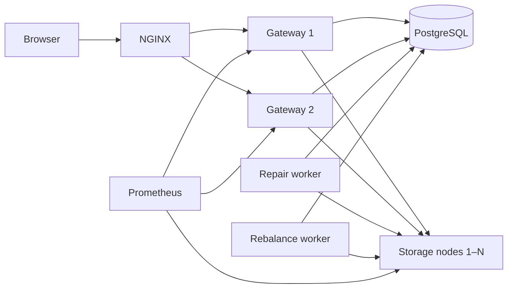

# Architecture

The Docker Compose prototype uses NGINX for client HTTP routing, two stateless FastAPI gateway replicas, PostgreSQL metadata, six separately volume-backed storage-node containers, one repair worker, one rebalance worker, Prometheus, and Grafana. Gateway APIs share PostgreSQL. Storage nodes write bytes to atomic temporary files and then rename them into their own volumes.

Data plane means gateway-to-node fragment operations. The control plane consists of node status, placement, repair, and rebalance decisions. PostgreSQL is a single local instance and remains a failure point. Containers on one machine do not create physical fault-domain separation.

The Reed–Solomon library is `zfec`, with k=4 and n=6. For each 24 MiB stripe, zfec produces six 6 MiB shards. Any four shards restore the original stripe after trimming padding to its recorded length. A 100 MiB file therefore has five stripes and 150 MiB theoretical fragment bytes (excluding filesystem overhead).

Placement uses deterministic weighted rendezvous scoring, weighted by free capacity, and requires distinct failure-domain values for every stripe. It filters unhealthy nodes, nodes below available space, and nodes above the 90% utilization watermark. Compose defaults to per-container domains; these are only logical demo domains, not independent physical machines.
